# Big Data — Pipeline de clima do AgroConecta

## Arquitetura

```
Airflow DAG agroconecta_pipeline_clima (diário 06:00, America/Sao_Paulo)
 ├─ coletar_ibge ───────► coletar_open_meteo ─┐
 ├─ coletar_produtores_mvp ───────────────────┼─► validar_chegada ─► databricks_disponivel? ─► enviar_para_volume ─► executar_lakehouse
 │                                            │      (JSONL ok?)        (short-circuit)        (Files API)           (Jobs API run-now)
 └─ chegada/<fonte>/dt=YYYY-MM-DD/*.jsonl ◄───┘

Databricks Job agroconecta_lakehouse:  01_bronze ─► 02_prata ─► 03_ouro
```

| Camada | Tabelas | O que acontece |
|---|---|---|
| **Bronze** `agroconecta_bronze` | `ibge_municipios`, `open_meteo_clima`, `mvp_produtores` | Auto Loader (`cloudFiles`) incremental com checkpoint; payload original preservado como texto JSON + linhagem (`_fonte`, `_coletado_em`, `_arquivo_origem`, `_ingerido_em`) |
| **Prata** `agroconecta_prata` | `municipios`, `clima_diario`, `produtores`, `quarentena` | Streaming incremental da Bronze + `foreachBatch`: schema explícito, padronização (datas, nome do município sem acento, unidades °F→°C, km/h→m/s), regras de qualidade (reprovados vão para `quarentena` com motivo), deduplicação, **MERGE** |
| **Ouro** `agroconecta_ouro` | `fato_clima`, `dim_localidade`, `dim_tempo`, `dim_produtor`, `vw_alertas_produtor` | Modelo estrela em SQL, alertas agroclimáticos (geada, chuva forte, calor, estresse hídrico, vento), mascaramento LGPD |

### LGPD
* O CPF só existe na Bronze (schema de acesso restrito).
* Na Prata o produtor vira `id_produtor = SHA-256(CPF + sal)`. O sal fica em um *secret scope*, nunca no código.
* Na Ouro, nome, telefone e e-mail são mascarados (`Rita S. S.`, `(15) *****-2535`, `r***@exemplo.com`).
* O cadastro em `dados_exemplo/` é **fictício**, com CPFs sintéticos. Ele traz 3 inconsistências de propósito (duplicado, CPF inválido, município ausente) para demonstrar a quarentena.

## Como executar

### 1. Databricks (uma vez)
1. Importe os arquivos de `databricks/` no workspace (Workspace → Import), por exemplo em `/Workspace/Users/<seu-email>/agroconecta/`.
2. Rode `00_setup.sql`.
3. Opcional: crie o secret scope `agroconecta` com a chave `lgpd_salt`.
4. Crie o Job: Jobs → Create Job → *JSON*, cole `job_agroconecta_lakehouse.json` e troque `SEU_EMAIL`. Anote o **Job ID**.
5. Gere um token: User Settings → Developer → Access tokens.

### 2. Airflow (Docker)
```bash
cd bigdata/airflow
cp .env.example .env      # preencha DATABRICKS_HOST, DATABRICKS_TOKEN, DATABRICKS_JOB_ID
docker compose up -d
```
Acesse http://localhost:8080, ative o DAG `agroconecta_pipeline_clima` e clique em *Trigger*.
Sem as variáveis do Databricks, o DAG grava só em `chegada/` e pula o envio (short-circuit).

### 3. Testar a coleta sem Airflow
```bash
cd bigdata
PYTHONPATH=airflow/dags python -c "from pathlib import Path; from agroconecta import coletores as c; a,co=c.coletar_ibge(c.carregar_municipios(Path('airflow/config/municipios_atendidos.json')),Path('chegada'),'2026-11-06'); c.coletar_open_meteo(co,Path('chegada'),'2026-11-06')"
```

## Consultas SQL (`databricks/04_consultas.sql`)
1. Previsão dos próximos 7 dias por município, com nível de risco
2. Produtores afetados por alertas nos próximos 3 dias, por cultura
3. Balanço hídrico semanal (chuva − evapotranspiração) com recomendação de irrigação
4. Média móvel de 7 dias de temperatura e chuva acumulada (window functions)
5. Ranking de risco climático por região, estação do ano e ano-safra
+ extra: monitor de qualidade (quarentena)

## Evidências de execução (Databricks Free Edition, 06/11/2026)

O relatório completo (PDF) traz estas figuras comentadas. Resumo:

| Figura | Notebook | O que mostra |
|---|---|---|
| 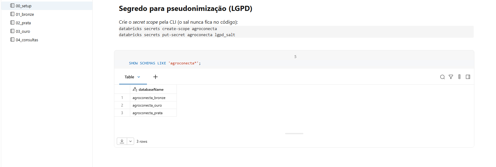 | `00_setup` | Os três schemas do Lakehouse criados |
| 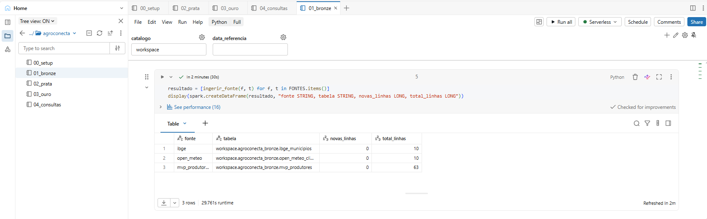 | `01_bronze` | 2ª execução: `novas_linhas = 0` (ingestão incremental) |
| 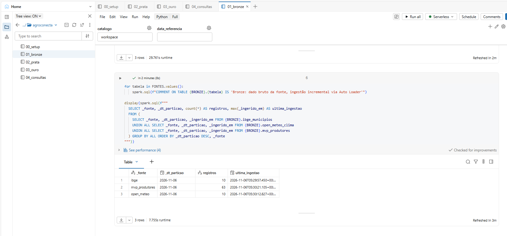 | `01_bronze` | Registros por fonte e partição `dt` |
| 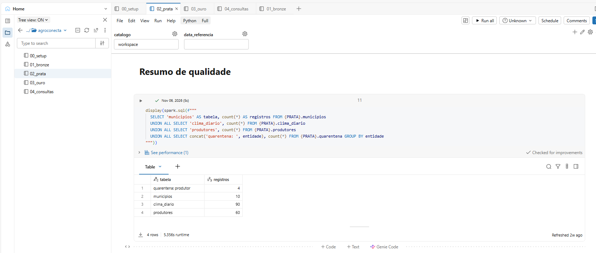 | `02_prata` | Resumo de qualidade: 10 municípios, 90 de clima, 60 produtores, quarentena |
| 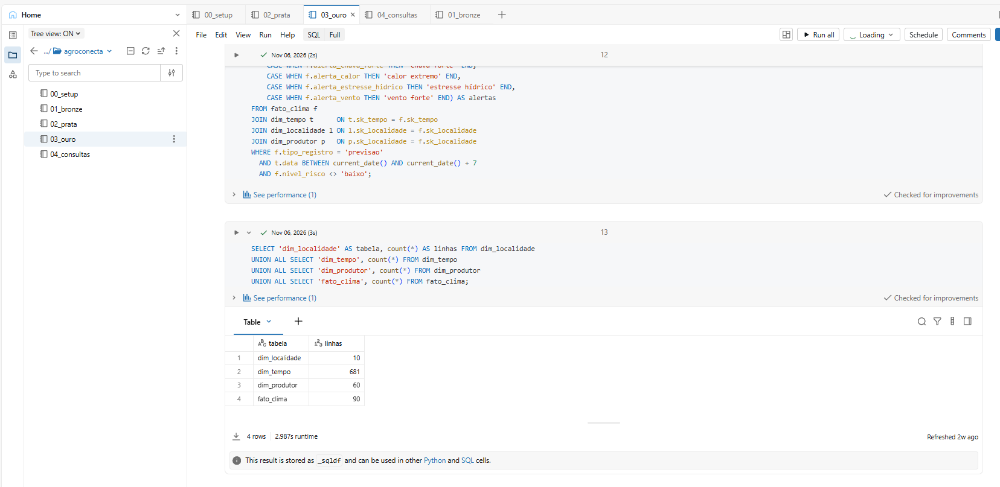 | `03_ouro` | Linhas da fato e das dimensões |
| 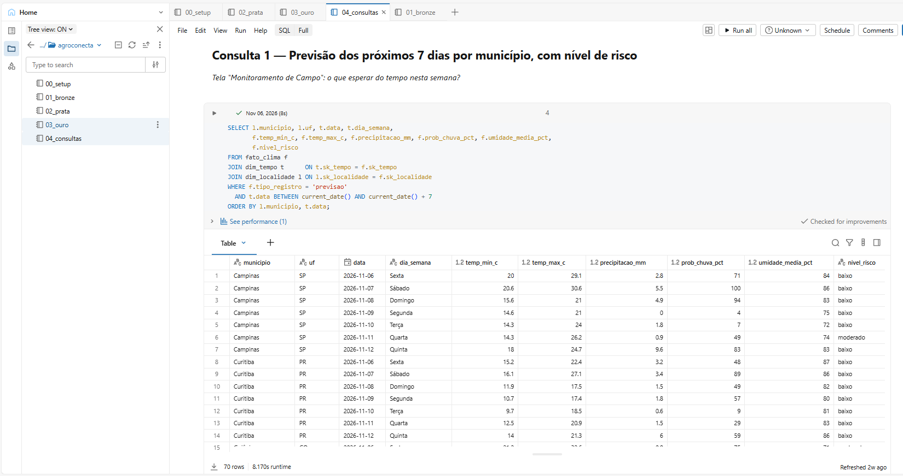 | `04_consultas` | Consulta 1: previsão de 7 dias com nível de risco |
| 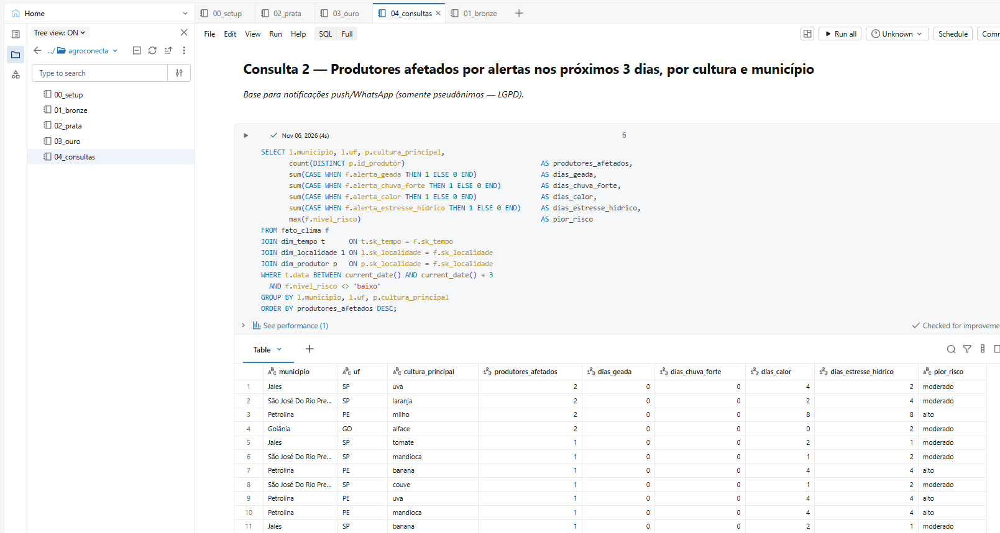 | `04_consultas` | Consulta 2: produtores afetados por alertas |
| 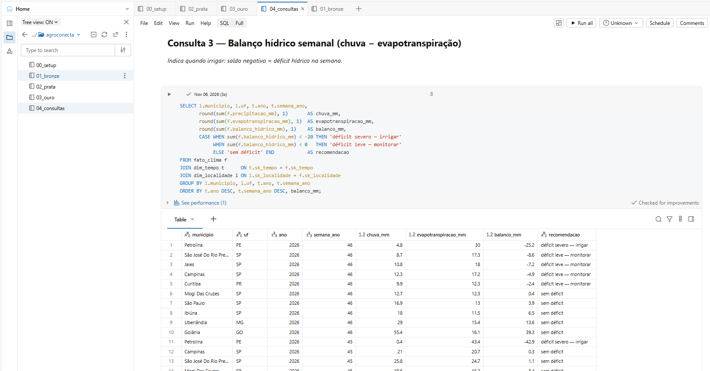 | `04_consultas` | Consulta 3: balanço hídrico semanal |
| 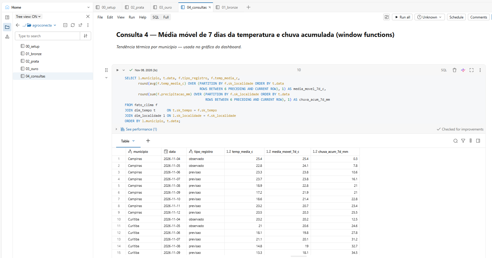 | `04_consultas` | Consulta 4: média móvel de 7 dias |
| 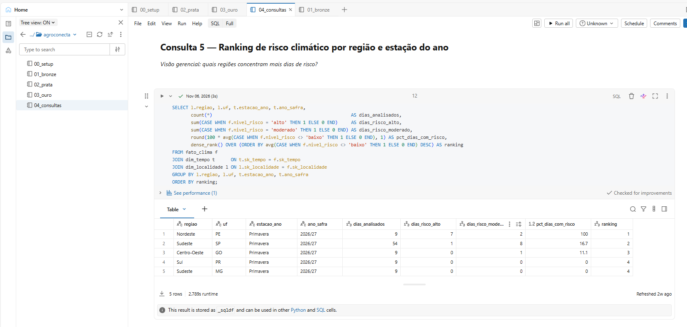 | `04_consultas` | Consulta 5: ranking de risco por região |
| 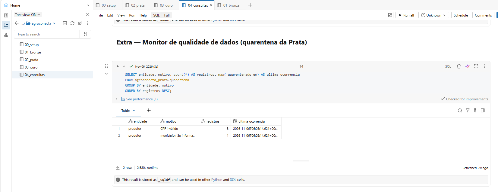 | `04_consultas` | Extra: monitor de qualidade (quarentena) |

**Quarentena com 4 linhas para 2 produtores:** duas execuções falharam durante o desenvolvimento depois de
gravar a quarentena, e o reprocessamento gravou os reprovados de novo. Prata e Ouro não foram afetadas (MERGE);
a quarentena também passou a usar MERGE (`id_quarentena`).

**Consulta 2 corrigida após o print:** o `JOIN` com `dim_produtor` multiplicava os dias de alerta pelo número de
produtores. A versão atual conta datas distintas (`count(DISTINCT …)`).
